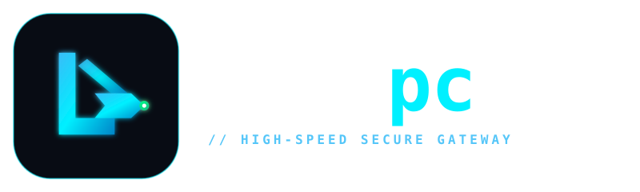

# linkpc — High-Speed Secure Client (Flutter + libbox)



**linkpc** — уникальный сверхлегкий кроссплатформенный клиент сетевого шлюза нового поколения на базе Flutter и ядра `sing-box` (`libbox`). Разработан специально для идеальной работы с инфраструктурой `vless.linkpc.net`.

---

## ⚡ Особенности приложения

- **Zero-Bloat & Ultra-Fast**: моментальный запуск, минимальное потребление RAM и аккумулятора.
- **VLESS + XHTTP Native Transport**: устойчив к любым блокировкам ТСПУ, обходит замедления и фильтрации.
- **Подключение в 1 клик**: футуристичная кнопка с динамической неоновой индикацией статуса.
- **Умное расщепление трафика (Smart Routing)**:
  - Российские сервисы, банки, Госуслуги, домены `.ru`, `.su`, `.рф` идут напрямую на полной скорости провайдера.
  - Международные ресурсы, AI-платформы (ChatGPT, Claude, Gemini, Cursor) и заблокированные сервисы идут через выделенный защищенный туннель.
- **Телеметрия в реальном времени**: живой пинг до шлюза в Москве/Ереване, скорости загрузки/отдачи, счетчик сессии.
- **Глубокая интеграция с сайтом**: автоматический импорт подписки по протоколу `linkpc://sub?url=...` прямо из личного кабинета.
- **Киберпанк-эстетика**: фирменная темная палитра `void` (`#040508`), неоновый циановый акцент (`#00F0FF`) и изумрудный индикатор активности (`#00FF88`).

---

## 🎨 Фирменный стиль и палитра

| Элемент | Hex / Цвет | Назначение |
|---|---|---|
| **Void Black** | `#040508` / `#080C14` | Основной фон приложения |
| **Cyber Surface** | `#0F1623` | Карточки и стеклянные панели |
| **Cyber Cyan** | `#00F0FF` | Фирменный акцент, кнопки, логотип |
| **Sky Glow** | `#38BDF8` | Вторичный акцент, бейджи |
| **Neon Emerald** | `#00FF88` | Активное зашифрованное соединение |
| **Border Slate** | `#1A2436` | Тонкие технологичные границы |

---

## 📱 Поддерживаемые платформы

- **Android**: 5.0+ (ARM64, ARMv7, x86_64)
- **Windows**: Windows 10 / 11 (64-bit)
- **macOS**: macOS 12+ (Intel & Apple Silicon)
- **Linux**: Ubuntu / Debian / Arch / Fedora (x86_64)
- **iOS**: iOS 15+ (через NetworkExtension / TestFlight)

---

## 🚀 Сборка и релизы через GitHub Actions

В репозиторий встроены автоматические пайплайны GitHub Actions:

- **`.github/workflows/release.yml`** — Полный пайплайн релиза и публикации:
  1. Автоматически срабатывает при пуше тега версии (`git push origin v1.0.14`), публикации релиза через вкладку **Releases** на GitHub или при ручном запуске в табе **Actions** (с выбором версии, генерацией Release Notes и флагами draft/prerelease).
  2. Создает GitHub Release с автоматически сформированным списком изменений (Release Notes).
  3. Собирает и прикрепляет к релизу готовые дистрибутивы для всех платформ:
     - Android: `linkpc-android.apk` (ARM64-v8a)
     - Windows: `linkpc-windows-x64.zip` (со встроенным `sing-box.exe` и `wintun.dll`)
     - macOS: `linkpc-macos.zip` (Universal binary Intel + Apple Silicon)
     - iOS: `linkpc-ios.ipa` (unsigned для AltStore / Sideloadly / TrollStore)
     - Linux: `linkpc-linux-x64.tar.gz` (со встроенным `sing-box`)

- **`.github/workflows/build-clients.yml`** — Ручная сборка артефактов без публикации релиза (для тестирования).

---

## 💻 Локальная разработка

### Запуск через VS Code / Cursor / IDE
В проект добавлены готовые конфигурации:
- **`.vscode/launch.json`**: запуск и отладка приложения (F5 / Run & Debug) в режимах Debug, Profile, Release, а также быстрый выбор целевой платформы (macOS, Android, Windows, Linux, iOS).
- **`.vscode/tasks.json`**: быстрые задачи сборки и создания релизного тега Git.

### Запуск через терминал
```bash
# Клонировать репозиторий
git clone https://github.com/<ваш-аккаунт>/linkpc.git
cd linkpc

# Установить зависимости Flutter
flutter pub get

# Запуск в режиме разработки
flutter run
```
